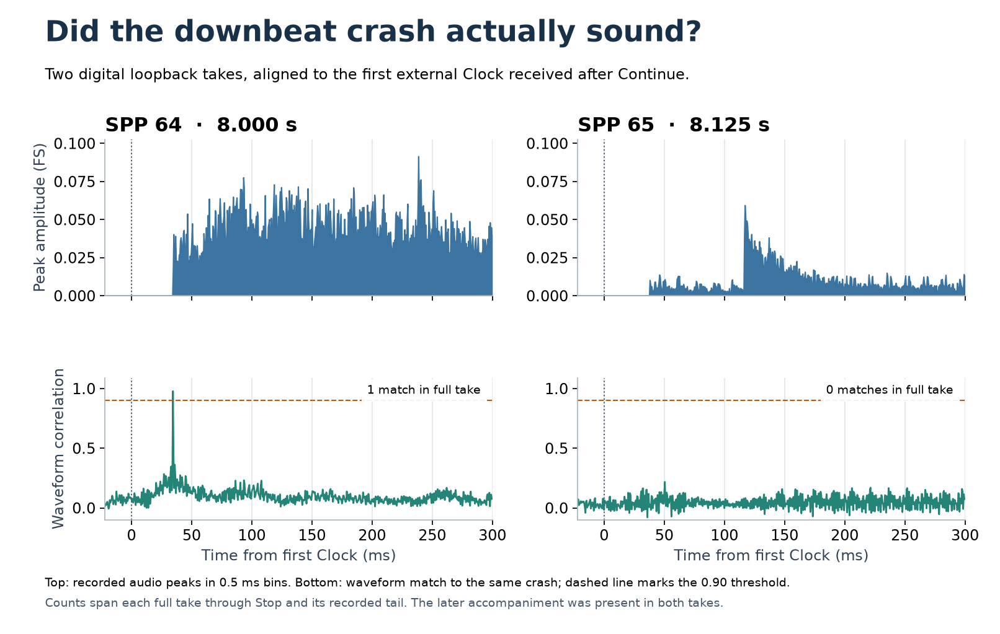
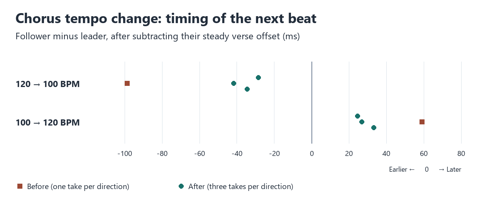
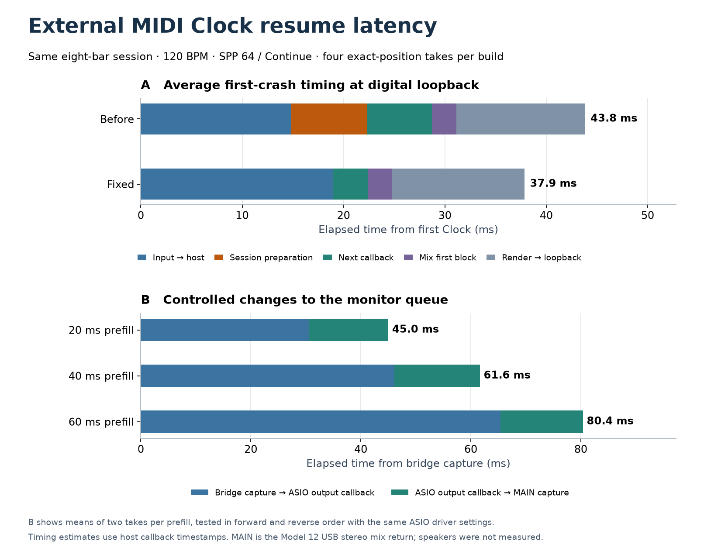
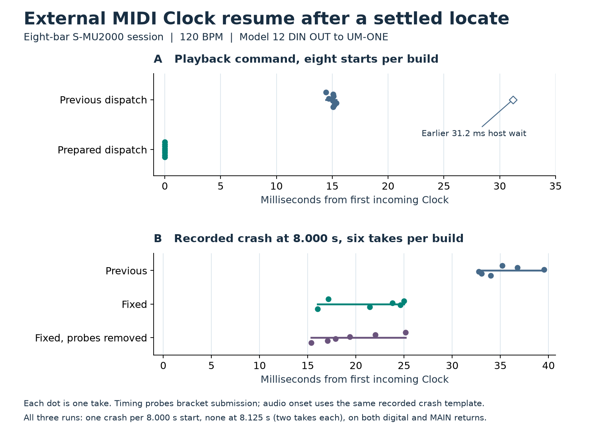
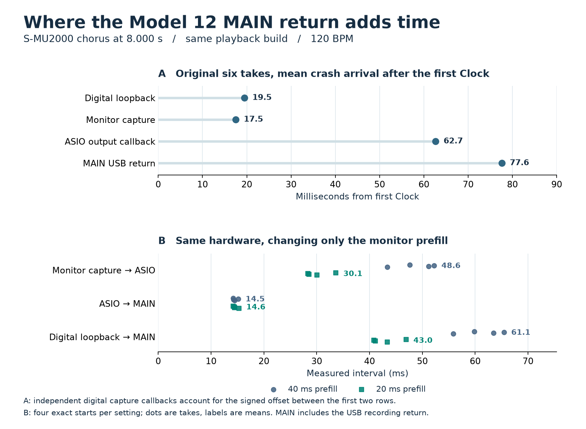
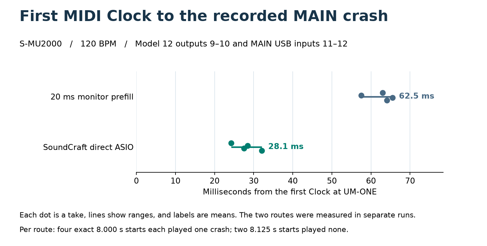
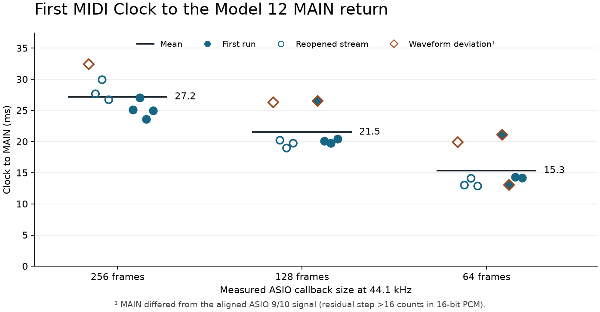
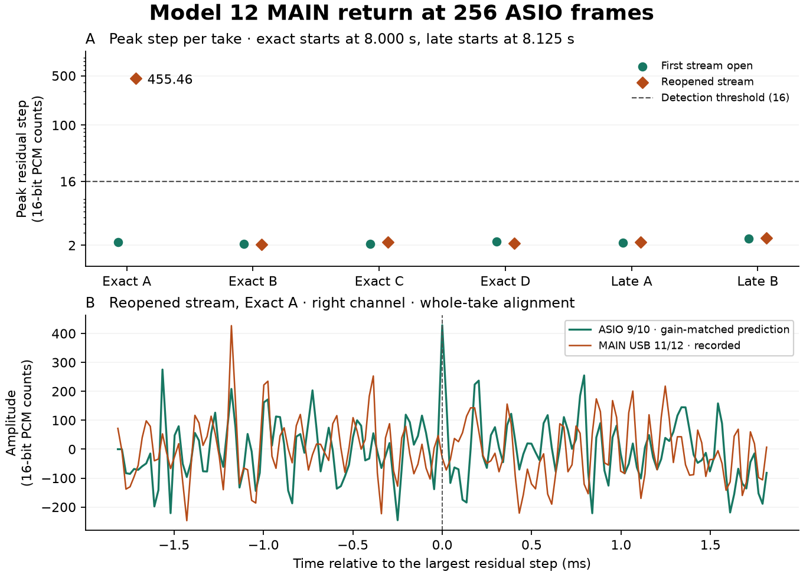
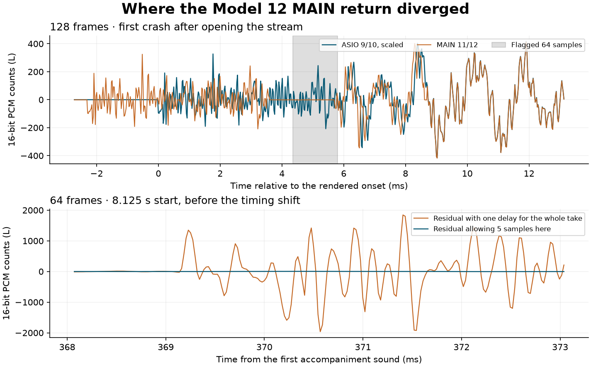
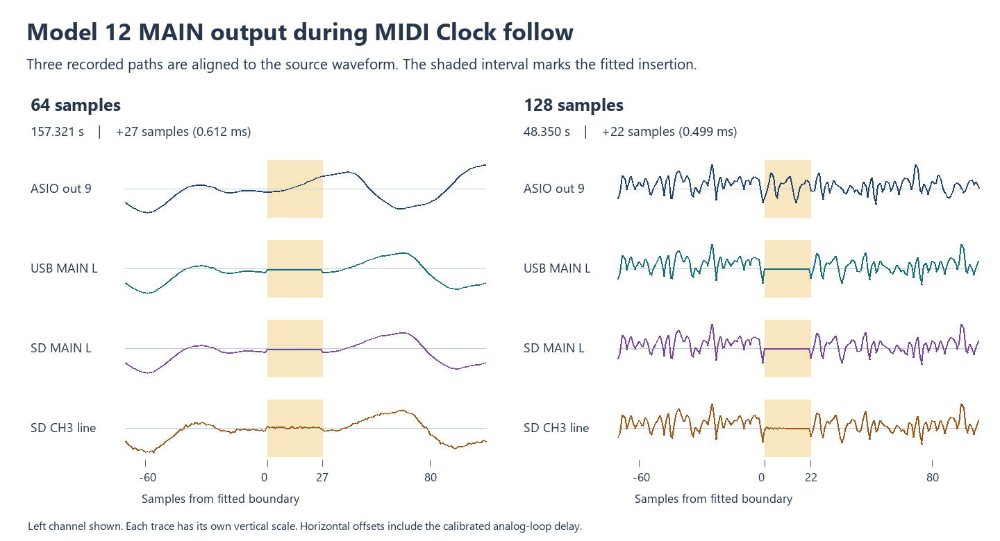

# External MIDI Beat Clock follow on the TASCAM Model 12

SoundCraft played the chorus crash once when the external sequencer resumed on its onset at 8.000 s. Resuming one sixteenth later at 8.125 s skipped the crash and played the following accompaniment. With the same project and a 256-frame buffer, sending audio directly to ASIO 9/10 reduced the mean time from the first MIDI Clock to the recorded MAIN return from 62.49 to 28.07 ms on this setup.

## Signal paths and controls

- **Transport.** The Model 12 recorder drove SoundCraft through its DIN OUT and a Roland UM-ONE. Model 12 USB MIDI and the independent UM-ONE capture each saw 842 clocks, Start, Continue and two Stops. After a backward Song Position Pointer (SPP) from 88 to 41, SoundCraft resumed and stopped. Both passes measured 120.00 BPM on the wire.
- **Tempo and loss.** For repeatable tempo changes, the computer sent MIDI through Model 12 USB MIDI → hardware DIN OUT → UM-ONE → SoundCraft. At zero input calibration, the script switched from 120 to 100 BPM, interrupted Clock for 1.1 s and located backwards to SPP 12 (sample 72,000 at 48 kHz). Coast kept playback rolling and Stop on loss stopped it. Each policy passed all eight transport checks on Windows integration build `0a8f553`. The later audio/MIDI **recording** regressions on `ed7ae31` used simulated input.
- **Audio.** The timing runs used the same eight-bar S-MU2000 accompaniment at 120 BPM in 4/4. Each short run sent SPP, Continue, 144 clocks and Stop. For the bridged route, a 48 kHz Windows digital loopback fed a monitor process that sent audio to Model Mixer ASIO 9/10 at 44.1 kHz. For the direct route, SoundCraft opened 9/10 itself. “MAIN USB” below means the stereo mix returned on USB 11/12. The nine-minute runs also captured the physical MAIN line outputs on the SD recorder. Loudspeaker latency was outside these measurements.

## Resume on the chorus boundary

At 120 BPM each SPP unit lasts 125 ms. We counted crash attacks against a from-head reference, including the tail after Stop, and checked that the later accompaniment still matched. The original Windows integration missed the exact-position crash. Preserving the requested musical origin separately from the latency-compensated render cursor restored it.

| Start position | Initial physical-loop results on digital output and MAIN USB |
| --- | --- |
| SPP 60 · 7.500 s | One crash after the lead-in (one take). |
| SPP 64 · 8.000 s | Exactly one crash as the first audible attack (two takes). |
| SPP 65 · 8.125 s | Zero crashes (two takes). Later accompaniment correlation exceeded 0.997. |

## Eight-bar accompaniment at 120 and 100 BPM

At 48 kHz, the same S-MU2000 project contains five tick-based MIDI clips spanning 32 quarter notes. The Model 12 started each take from the top and supplied Beat Clock over DIN through the UM-ONE. We counted snare onsets independently in the digital accompaniment and the Model 12 MAIN USB return (11/12), matching against the project’s snare sample. The PC1X was idle during the accompaniment.

| Model 12 tempo | Before, digital / MAIN snares | After, digital / MAIN snares | Measured beat on MAIN | Final hi-hat after chorus crash on MAIN | Eight-bar clip end on the grid |
|---|---|---|---|---|---|
| 120 BPM | 8 / 8 | 8 / 8 | 499.86 ms | 7.748 s | 16.000 s |
| 100 BPM | 5 / 5 | 8 / 8 | 600.23 ms | 9.303 s | 19.200 s |

Both corrected takes had one chorus crash on each path and followed Stop. At 100 BPM the final three snares belong at 16.2, 17.4 and 18.6 s, beyond the original 16 s clip boundary. An initial corrected 100 BPM take captured digital audio only. The repeated take supplied both paths in the table. A separate physical MIDI loop replay of the captured 883 and 904 clock pulses at 100 and 120 BPM, respectively, also produced all eight snares in each digital recording.

The external-clock regression renders the eight notes on a temporary playback grid and checks the saved clip still ends on its original grid. Ordinary session tempo edits reproduce the same audible loss on upstream main without MIDI hardware. The main-targeted work is tracked separately in [PR #785](https://github.com/storytold/soundcraft/pull/785) and [issue #1690](https://github.com/storytold/soundcraft/issues/1690).

## Changing tempo at the chorus

Two SoundCraft instances played eight bars in 4/4. The leader sent Beat Clock through Model 12 USB MIDI → DIN OUT → Roland UM-ONE and changed tempo at bar 5. We captured both instruments on separate channels of one 48 kHz Windows digital loopback. The full performance contained all 32 drum beats and 64 S-MU2000 bass attacks in both directions. Starting at the chorus produced 16 beats and 32 bass attacks in each direction.

For timing, we substituted a short hi-hat for the bass and matched each channel against its own percussion sample (normalized correlation above 0.85). The table gives follower minus leader on bar 5 beat 2, relative to the median offset on song beats 5–14. Negative values mean the follower played early.

| Tempo step | Before, one take per direction | After, three takes per direction |
| --- | ---: | --- |
| 120 → 100 BPM | −98.68 ms | −28.48, −41.79, −34.46 ms |
| 100 → 120 BPM | +59.09 ms | +24.54, +26.78, +33.15 ms |

All six post-fix takes contained the expected attacks. Across the six takes, the final four beats' median offset was within 4.05 ms of the verse baseline. The very first attack after Start had a separate 40–50 ms raw offset on this two-instance setup. These captures measure digital output. The physical MAIN measurements below used separate runs.

The deterministic regression drives the actual input and playback grid with a 30 ms render horizon. On the previous head (`5b1418a8`), the next backbeat landed 4,552 samples early at 48 kHz on the slowdown. The revised estimator and grid pass the one-Clock tolerance in both directions and preserve the bar-5 downbeat in this test.

## From the first Clock to the first mixed block

Four exact starts per build isolated repeated project and instrument preparation on Continue. Probes timestamped MIDI input, host processing, session preparation, command receipt and completion of the first mixed block. Times are in milliseconds.

| Interval | Before snapshot reuse | With snapshot reuse |
| --- | ---: | ---: |
| First Clock to host processing | 14.5–15.0 | 14.7–31.2 |
| Session preparation | 7.404–7.565 | 0.001–0.002 |
| Play command to callback | 2.9–9.6 | 1.0–7.4 |
| Callback to completed first mix | 2.1–2.8 | 2.1–2.8 |
| First Clock to completed first mix | 27.6–34.9 | 18.5–34.6 |
| First mix to digital loopback | 12.4–13.0 | 11.8–14.6 |
| First Clock to digital crash, mean (range) | 43.8 (40.3–47.9) | 37.9 (31.9–47.2) |

The 31.2 ms host wait prompted a second comparison. The original take had no OS scheduling trace. Eight starts on `f5de549` showed that dispatch still waited for a GUI frame. Six exact starts and two late starts per build then compared that path with first-Clock dispatch from a prepared, stopped locate.

| Interval | Host-frame dispatch | Prepared dispatch |
| --- | ---: | ---: |
| First Clock to Play command, eight starts | 14.427–15.367 ms | 0.001–0.002 ms |
| First Clock to digital crash, mean of six exact starts | 35.2 ms | 21.3 ms |
| First Clock to MAIN USB crash, mean of six exact starts | 92.6 ms | 77.6 ms on the final build without probes |

With probes removed, digital onset averaged 19.5 ms (15.3–25.2 ms). The command measurements sampled just before submission on the earlier build and just after return on the fixed build. In each batch, digital and MAIN captured one crash per exact start and zero per late start.

## Monitor prefill and direct ASIO

Six exact starts averaged 19.47 ms to digital loopback and 77.61 ms to MAIN USB. Of the additional 58.14 ms, monitor capture to ASIO callback accounted for 45.13 ms and callback to MAIN return for 14.95 ms. The independent monitor timestamp preceded the digital witness by 1.94 ms. The earlier observation of about 77 ms *between* digital and MAIN had fewer taps, so its exact split is unknown.

After warming the streams, two passes in opposite prefill order gave digital-to-MAIN times of 45.1 / 41.1 ms (20 ms prefill), 59.3 / 60.3 ms (40 ms) and 82.3 / 74.5 ms (60 ms). An exploratory 20 ms run before warm-up took 145.9 ms across the bridge. A separate 256-frame comparison alternated 40 and 20 ms prefill, with four exact and two late starts per setting.

| Mean of four exact starts | 40 ms prefill | 20 ms prefill |
| --- | ---: | ---: |
| Monitor capture to ASIO output callback | 48.59 ms | 30.14 ms |
| ASIO output callback to MAIN USB | 14.50 ms | 14.59 ms |
| Digital loopback to MAIN USB | 61.15 ms | 43.04 ms |
| First Clock to MAIN USB | 83.15 ms | 62.49 ms |

Replaying the recorded crash straight to ASIO 9/10 gave 14.38–15.61 ms from output callback to MAIN USB in six repetitions. The interval includes the driver, device and USB capture. These timestamps cannot assign a one-way delay to each stage.

Direct SoundCraft playback used Clock follow at `2b53c7e` with the Windows sample-format and hardware routing from #1634 and #1635. The driver accepted one ASIO client, so a diagnostic copied duplex input 11/12 to a background writer. Both routes used a 0.90 waveform-match threshold and the same 6.80 ms input-time correction.

| First Clock to MAIN USB, four exact starts | Mean | Range |
| --- | ---: | ---: |
| 20 ms monitor prefill, 256 frames | 62.49 ms | 57.47–65.47 ms |
| Direct ASIO 9/10, 256 frames | 28.07 ms | 24.21–32.03 ms |

The direct route saved 34.42 ms on average across these separate runs. MAIN contained the crash once in all four exact starts and zero times in both late starts. The later accompaniment matched in all six (minimum correlation 0.994).

## Driver buffer size and waveform detection

Requesting 128 or 64 frames while the TASCAM panel was set to 256 still delivered 256-frame input and output callbacks. We changed the panel, reopened the stream twice per setting and measured the actual sizes in both directions. Each row covers eight exact and four late starts at 44.1 kHz. The timing mean uses the eight exact starts.

| Actual input/output frames | First Clock to MAIN USB, mean (range) | Input timestamp correction | Takes with residual steps | Low-level windows |
| --- | ---: | ---: | ---: | ---: |
| 256/256 | 27.20 ms (23.59–32.43) | 6.803 ms | 1/12 | 0 |
| 128/128 | 21.52 ms (18.97–26.59) | 3.900 ms | 2/12 | 1 |
| 64/64 | 15.33 ms (12.87–21.14) | 2.449 ms | 4/12 | 0 |

All 24 exact starts produced one crash each. All 12 late starts had zero crashes and retained the later accompaniment. No clipping or gaps in the callback capture sequence were detected. The cause of the single 256-frame waveform deviation remains open.

**How the detector works.** Align the native ASIO 9/10 output to the simultaneous MAIN USB 11/12 return once per take, fit stereo gain, then look for steps in the residual greater than 16 counts in 16-bit PCM units. The low-level detector flags 64 consecutive samples whose MAIN RMS falls below 20% of the expected RMS when the expected level exceeds 30 counts. Copies of a clean take with a 64-frame mute and a one-sample spike served as positive controls. A timing shift can trigger the residual test even when the signal level is intact.

**256-frame exception.** Reanalysis of all 12 paired WAVs identified the first exact start after reopening the stream (`repeat2-256/exact-a`). The peak sample-to-sample change in the residual was 455.46 counts on the right channel, compared with 2.06–2.54 in the other 11 takes (flag threshold 16). The whole-take alignment placed MAIN 1,326 frames after the ASIO output. No take triggered the low-level detector. The flagged take played the crash once, with continuous input/output callback sequence numbers and no clipped frames in the MAIN capture. Its cause and audibility remain undetermined.

At 128 frames, a 64-sample window (1.45 ms) measured 14.9 counts RMS on MAIN against 98.4 on gain-matched output. It began 4.35 ms into the crash. Independent replays of the original 128-frame output and of three flagged 64-frame takes yielded clean MAIN returns. Two of the four 64-frame flags were cold starts. The other two fit a change in relative alignment of five or six samples, reducing residual steps below 2.4 counts.

On fresh cold starts, the first sounding callback took 10.64 ms at 128 frames (2.90 ms budget), including 10.04 ms inside S-MU2000. At 64 frames it took 7.28 ms (1.45 ms budget), including 6.78 ms inside the plug-in. These elapsed times include scheduling. Both showed a MAIN deviation, but the specific 128-frame RMS drop did not recur. A control copy with the verse-bass VST3 assignment removed retained the four drum instruments, took 0.12 ms for the first 64-frame block and produced six clean returns. With the original project, all 12 exact and six late resumes in this follow-up passed the crash-count checks.

## Physical MAIN and USB return over nine minutes

A subsequent run used the prewarmed S-MU2000 project and captured native ASIO 9/10 output, MAIN USB 11/12, internal MAIN on SD, and physical MAIN L/R looped back to CH3/4 on SD (PRE COMP, both channels unassigned from MAIN and SUB). Level and routing stayed fixed. Each actual buffer size ran for nine minutes from 8.000 s, with a 44.1 kHz/24-bit SD song, 25,920 clocks and 34 crash onsets on both ASIO and MAIN USB. The 8.125 s check above comes from the short runs.

| Observation | 64 frames | 128 frames |
| --- | --- | --- |
| ASIO input/output blocks per direction | 372,091, sequence continuous | 186,045, sequence continuous |
| Callback overruns / longest callback | 2 / 1.8131 ms | 2 / 3.6704 ms |
| Extra near-silent samples on all three MAIN paths | +14 at 152.290 s and +27 at 157.321 s | +22 at 48.350 s |
| Shorter alignment on MAIN USB only | 5–6 samples at three points | 5 samples at three points |
| Blind A/B of the longest insertion versus a matched phrase | Listener reported a click in B, the +27-sample excerpt | Listener could not distinguish the +22-sample excerpt |

The earlier +40-sample event at 13.498 s did not recur at the matching phrase. Independent windows before, after and across that phrase located the same source sample (correlation >0.9998). Adding 40 measured background samples to copies of each SD track recovered +40. Unmodified copies measured zero. At the three new positive shifts the ASIO output continued to carry signal and all three MAIN paths gained a low-level interval. Only the +27 event was near an over-budget callback. The captures locate the change downstream of the output PCM. The individual driver, USB output and device stages remain unresolved.

Each blind comparison used one 1.6 s excerpt per condition from the physical return, level-matched to another pass through the same phrase. Replays kept the same order, and the keys were opened after both responses. This tests those two excerpts only. The short-run 128-frame dropout above and the long-run +22-sample excerpt are different events.

